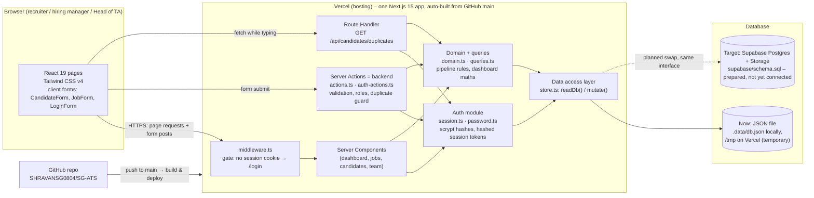

# Meridian ATS – Architecture

## Diagram

No AI/LLM service is called by the application. The client brief lists "anything AI-powered" as *Won't have* in v1.
AI (Claude Code) was used to **build** the app, not inside it.

## Layers

| Layer | Technology | Where |
|---|---|---|
| Frontend | Next.js 15 App Router, React 19, TypeScript, Tailwind CSS v4 | `src/app/**`, `src/components/**` |
| Backend / API | Next.js Server Actions (no separate API server) + 1 Route Handler | `src/lib/actions.ts`, `src/lib/auth-actions.ts`, `src/app/api/candidates/duplicates/route.ts` |
| Business logic | Pure TypeScript domain rules and queries | `src/lib/domain.ts`, `src/lib/queries.ts` |
| Database | Data access layer over a JSON file today; Supabase Postgres schema prepared | `src/lib/store.ts`, `supabase/schema.sql` |
| Authentication | Built-in email + password: scrypt, server-side sessions, role checks | `src/lib/session.ts`, `src/lib/password.ts`, `src/middleware.ts` |
| AI / LLM | None in the product (out of scope for v1) | `package.json` dependencies: next, react, react-dom, server-only |
| Hosting | Vercel, built from the GitHub `main` branch | https://sg-ats.vercel.app |

## Request flow example: recruiter adds a candidate

1. Browser loads `/candidates/new` → `middleware.ts` checks for a session cookie → server component renders the form.
2. While typing a phone/email, the form calls `GET /api/candidates/duplicates` (requires sign-in) → `findDuplicates()` in `queries.ts`.
3. Submit → Server Action `createCandidate()` → checks role (`requireEditor`), validates fields, requires DPDP consent, re-checks duplicates on the server → `mutate()` in `store.ts` writes the record.
4. Next.js revalidates the pages and redirects to the new candidate's profile.

## Architecture decisions

### ADR-1: One full-stack Next.js app with Server Actions instead of a separate frontend + REST API

- **Considerations:** time to MVP (client wants something working in 2 weeks), one language and codebase for a small team, lowest hosting cost, natural fit with Vercel.
- **Decision:** pages render on the server; every write goes through a Server Action, which checks roles server-side. Only the live duplicate check needed a Route Handler.
- **Trade-off:** fast to build and secure by default, but there is no public REST API, so future integrations (Naukri/LinkedIn, a client-facing status report, mobile app) will need Route Handlers to be added. The app is also tied to Next.js conventions.

### ADR-2: A swappable data access layer: JSON file now, Supabase Postgres as the target

- **Considerations:** data shape (many-to-many candidate ↔ job, full stage history), integrity, DPDP retention, resume storage, cost, speed of the first demo.
- **Decision:** all code goes through `readDb()` / `mutate()` in `store.ts`. A JSON file gave a zero-setup MVP. Postgres via Supabase is the target because the data is relational
  (`unique (candidate_id, job_id)`, foreign keys, `stage_events` history), it supports a scheduled DPDP purge on `retain_until`, and Supabase Storage covers the `resumes` bucket. Schema: `supabase/schema.sql`.
- **Trade-off:** fastest possible start with no accounts or keys, but a file is not durable on serverless hosting. This was hit for real: Vercel's read-only filesystem crashed the first deploy (fixed in commit `409c3cf` by using `/tmp`), and `/tmp` data can reset. The UI shows a "Demo mode" warning until Supabase is connected.

### ADR-3: Built-in email + password authentication instead of Clerk

- **Considerations:** security, who controls accounts, cost, setup time, data protection (DPDP), user experience.
- **Decision:** the client asked for staff to sign in with their own emails and passwords, created and controlled by the HR admin (internal tool, no public sign-up). Built in-house:
  scrypt password hashing, random session tokens stored only as SHA-256 hashes, httpOnly/SameSite cookies, 7-day expiry, 5-failure lockout, session revocation on password reset or deactivation, role checks on every action.
- **Trade-off:** no third-party keys or cost and credentials stay in our own database, but we carry the security burden ourselves. Features Clerk provides out of the box are missing: email-based "forgot password", multi-factor authentication and SSO. The lockout counter is held in server memory, so on Vercel's multiple instances it is weaker than a database-backed counter.
