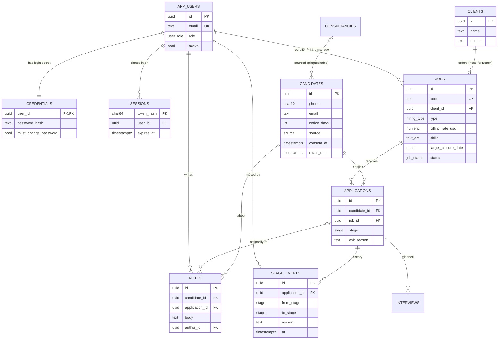

# Meridian ATS – Design & Data Model

Source of truth: types in [`src/lib/domain.ts`](../src/lib/domain.ts) (what the app uses today) and the Postgres schema in
[`supabase/schema.sql`](../supabase/schema.sql) (same entities; validated on PostgreSQL 16 – creates 11 tables).

## Entity–relationship diagram

| Entity | Purpose | Key rules |
|---|---|---|
| `app_users` | Staff who sign in: Head of TA, recruiters, hiring managers | unique email; `active=false` blocks sign-in |
| `credentials` | Password hash, kept apart from the profile so profiles can be sent to the browser safely | 1:1 with user; scrypt hash |
| `sessions` | One row per signed-in browser account | only SHA-256 of the token stored; 7-day expiry |
| `clients` | Overseas clients (banking, retail, logistics) | |
| `jobs` | Requisition tied to a client project, or the Bench | client required unless Bench; exp/CTC max ≥ min; auto code `REQ-0001` |
| `candidates` | Person + CTC, notice period, skills, source | phone normalised to 10 digits and indexed for duplicate detection; DPDP `consent_at` + `retain_until` |
| `applications` | **Join table**: candidate ↔ job (many-to-many) with current stage | `unique (candidate_id, job_id)`; exit reason for Rejected / Dropped Out |
| `stage_events` | Audit trail of every stage move, with who and when | append-only; source for funnel, drop-out rate, time-to-fill |
| `notes` | Free-text comments with author and time | optionally linked to one application |
| `consultancies`, `interviews` | In the schema for the next phase; not used by the app yet | the app currently uses a fixed consultancy list (`CONSULTANCIES` in `domain.ts`) |

## Key user flows

### Flow 1 – Recruiter registers a candidate against a job (without double-calling anyone)

1. Recruiter opens a job → **+ Add candidate** (`/candidates/new?jobId=…`); hiring managers are redirected away from this page.
2. Types the phone/email → the form calls `GET /api/candidates/duplicates` → `findDuplicates()` matches the normalised phone or email and returns **who owns the candidate, on which job, at which stage**.
3. Fills CTC, notice period, skills, source (consultancy name or referrer required when relevant) and ticks **DPDP consent**.
4. Submits → Server Action `createCandidate()`:
   role check (`requireEditor`) → field validation → consent required → **duplicate re-checked on the server** (blocked unless "this is a different person" is ticked) → writes `candidates` with `retain_until = now + 12 months` → writes `applications` (stage *Applied*) and the first `stage_events` row.
5. Recruiter lands on the candidate profile; the job's pipeline board now shows the candidate with a notice-period fit flag.

### Flow 2 – Candidate moves through the pipeline to Joined (or drops out), and leadership sees it

1. Recruiter opens the job's **pipeline board** (one column per stage, cards show notice fit, expected CTC, skill match).
2. Moves the candidate forward/back (Applied → Screened → Internal Interview → Client Round → Offered → BGV → Joined) → Server Action `moveStage()`:
   role check → stage validated → **Rejected / Dropped Out require a reason code** → updates `applications.stage` and appends a `stage_events` row (from, to, reason, who, when).
3. Recruiters and hiring managers add `notes` along the way (e.g. "holding a competing offer").
4. The candidate profile shows the full time-stamped history; the Head of TA's **dashboard** reads `stage_events` to compute the funnel, **offer → join drop-out rate**, source yield and time-to-fill.

## Role-based access control

Roles: `head` (Head of TA / HR admin), `recruiter` (employee), `hiring_manager` (manager). Enforcement happens in four layers; the **server checks are the real control** – hidden buttons are only convenience.

| Layer | Mechanism | Code |
|---|---|---|
| 1. Route gate | `middleware.ts` sends requests without a session cookie to `/login` | `src/middleware.ts` |
| 2. Session validation | `currentUser()` verifies the token hash, expiry and that the user is still active; otherwise redirects to `/login` | `src/lib/session.ts` |
| 3. Server-side permission checks | `requireEditor()` (head or recruiter) guards every write to jobs, candidates, applications and stages; `requireHead()` guards team management; the API returns 401 when signed out | `src/lib/actions.ts`, `src/lib/auth-actions.ts`, `src/app/api/candidates/duplicates/route.ts` |
| 4. UI | Pages hide edit controls with `canEdit()` / `isHead()` and redirect from pages a role may not use | `src/app/(app)/**` |

| Action | Head of TA | Recruiter | Hiring manager |
|---|:-:|:-:|:-:|
| View dashboard, jobs, candidates | ✅ | ✅ | ✅ |
| Add notes | ✅ | ✅ | ✅ |
| Create/edit jobs, assign recruiter | ✅ | ✅ | ❌ |
| Add candidates, apply to jobs | ✅ | ✅ | ❌ |
| Move pipeline stages, reject/drop | ✅ | ✅ | ❌ |
| Manage team (create users, roles, reset passwords, deactivate) | ✅ | ❌ | ❌ |
| Change own password | ✅ | ✅ | ✅ |

Known limits: hiring managers can see all jobs (not only their own), and Postgres row-level security is not set up yet – access is enforced in the application layer.
